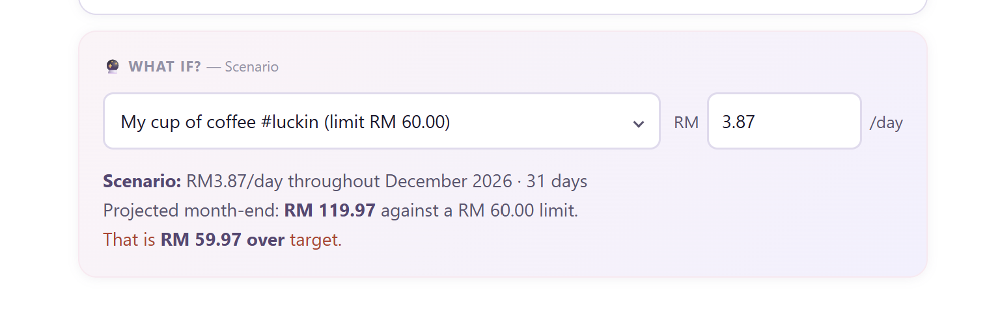

# My Budget

A mobile-first budget tracker built with Google Sheets and Apps Script. Log a payment on your phone, decide which month your income should fund, and see how much you can spend before payday. Each person runs their own copy in their own Google account.

## Why I built it

As a computer science student studying data analytics, I wanted to answer a question my spreadsheet kept getting wrong for me: **if my allowance arrives in November but pays for December, which month does it belong to?** I built My Budget to keep both answers. The calendar records when money moved. The monthly plan and overview show when I intend to use it.

I also wanted a tracker I would actually use after paying for lunch. Quick entry on my phone helps me collect the data. The analysis gives me a reason to come back to it.

## Inside the app

| Page | What you can do |
| --- | --- |
| Quick Add | Record an expense, income or savings entry with an amount, category, account, date and optional note. Assign income to this month, next month or split it. |
| Overview | Compare income assigned with spending, inspect category totals, edit transactions and check the daily allowance until payday. |
| Calendar | Tap a date to see the transactions recorded on that day. |
| My Plan | Set fixed-RM or percentage targets, then explore a purchase every day, week, fortnight or custom number of days. |
| Me | Customise categories, savings pots and accounts, including their display order. |

*An early daily scenario from the app. RM3.87 × 31 purchases comes to RM119.97, or RM59.97 over a RM60 limit. The current version also supports other purchase frequencies.*

## From transactions to insights

- **Monthly allocation.** A RM500 allowance received on 25 November with RM400 reserved for December contributes RM100 to November’s plan and RM400 to December’s. The calendar shows a single RM500 receipt. This keeps the totals reconcilable without duplicating transactions.
- **Payday pace.** The app subtracts logged cycle expenses from the cycle budget and divides the remainder by the calendar days left, including today and excluding payday. RM180 remaining across 10 days gives RM18 per day.
- **Historical comparison.** The payday card calculates average spend on prior days in the cycle with logged expenses once at least three such days exist. Its denominator matters: an unlogged day could mean I forgot to enter lunch.
- **Scenario analysis.** Projected month-end spending equals recorded category spending plus the amount per purchase multiplied by the number of planned purchases. For a future month, the first purchase falls on day one. For the current month, additional purchases start tomorrow.

**A future experiment:** compare a weekday/weekend spending estimate with a simple daily-average baseline. Train on earlier pay cycles, evaluate on later completed cycles, and report mean absolute error in RM. This is a proposed extension; the current What If feature uses the frequency selected by the user.

## How the data is stored

The interface calls Apps Script, which reads and writes three tabs in the owner’s Google Sheet.

| Sheet tab | Contents |
| --- | --- |
| Tracker Entries | One row per transaction, with a stable ID, date, item, type, amount, category, account and income reserved for next month. |
| Settings | Key/value pairs for pay-cycle dates, budgets and profile preferences. |
| Plans | One row per monthly target, including its ID, type, fixed amount or percentage and linked categories. |

The one-time setup stores the owner’s spreadsheet ID in their Apps Script project properties under `BOOK`. The public source contains the setup logic and fictional local-preview records. The live transaction history stays in the spreadsheet.

## Set up your own copy

1. Create a **blank Google Sheet** in your own Google Drive. Give it a name such as **My Budget**.
2. In that Sheet, choose **Extensions → Apps Script**.
3. Open the repository’s **Code.gs** and copy its full contents. In Apps Script, click inside the default **Code.gs**, select all and paste. The first line of the supplied code should be at the top of the file, outside the default myFunction wrapper.
4. In the editor’s Files panel, click **+ → HTML**, name it **Index**, and replace its contents with the repository’s **Index.html**. Save both files.
5. Select **setup** in the function dropdown and click **Run**. Review the requested permissions using the same Google account. When execution completes, check your Sheet for **Tracker Entries**, **Settings** and **Plans**.
6. Choose **Deploy → New deployment → Web app**. Set **Execute as** to **Me** and **Who has access** to **Only myself**, then click **Deploy**. Copy your own URL ending in **/exec**.
7. Open that URL, add a sample expense and check that one row appears in your **Tracker Entries** tab. Tap the transaction in Overview to edit or delete the sample.

For later releases, update the files and use **Deploy → Manage deployments → Edit → New version → Deploy** to keep your existing URL.

### Put the white wallet icon on iPhone or iPad

1. On your laptop, open **ios/My-Budget.mobileconfig** in a plain-text editor.
2. Find **YOUR_APPS_SCRIPT_EXEC_URL** and replace only that text with your own complete **/exec** URL. Keep the surrounding XML tags. The icon and full-screen setting are already included.
3. Save with the **.mobileconfig** extension. Transfer your edited file to your device, open it and allow the profile download if prompted.
4. Open **Settings → Profile Downloaded → Install**. The unsigned profile contains one removable Web Clip. Review its destination in the profile details. Tap **My Budget** on the Home Screen and sign in to your Google account if prompted.
5. Repeat on your iPad using the same personalised file.

## Stack

HTML, CSS and vanilla JavaScript for the interface, Google Apps Script for application logic, and Google Sheets for storage. The live app requires an internet connection. The local preview uses fictional records and browser storage.

[Google Apps Script web app documentation](https://developers.google.com/apps-script/guides/web) · [Apple profile installation guide](https://support.apple.com/en-gb/102400)
