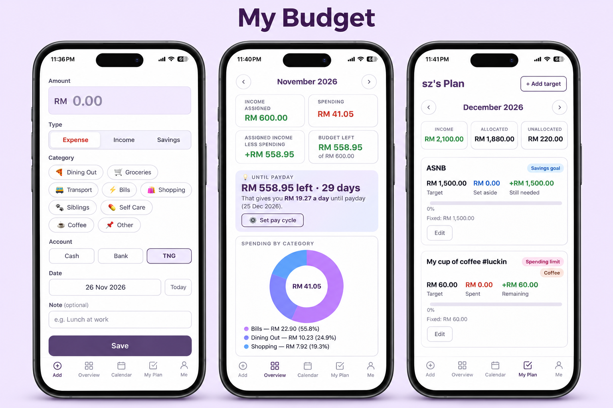
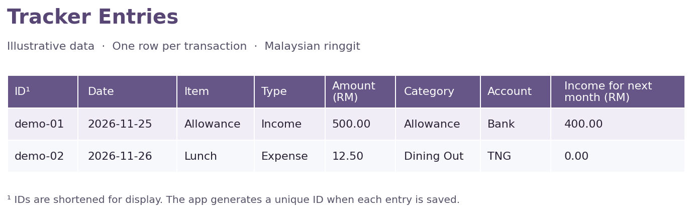

<h1 align="left">My Budget 💜</h1>

  A mobile-first budget tracker for logging payments, planning next month’s income, 
  and working out how much you can spend before payday.

  <a href="#inside-the-app">Explore the app</a> ·
  <a href="#budget-insights">See the analysis</a> ·
  <a href="#setup">Set up your own copy</a>

  
   

## 💭 Why I built it

**If my allowance arrives in November but pays for December, which month does it belong to?**

As a computer science student studying data analytics, I realised I was asking one date to answer two questions. In My Budget, the **transaction date** tells me when the money moved. The **budget month** tells me when I plan to use it. I can receive money in November, reserve it for December, and still trace it back to one payment.

I also wanted something I’d actually open after paying for lunch. Logging a payment takes a few taps on my phone. Later, those entries help me decide whether there’s room for another coffee before payday.

## 📱 Inside the app

| Page | What I use it for |
| --- | --- |
| **Quick Add** | Log an expense, income or savings entry. Choose the account and category, add an optional note, and assign income to this month, next month or both. |
| **Overview** | See how much I can spend per day until payday, compare spending by category, and open a transaction to edit it. |
| **Calendar** | Tap a date to see what came in and went out that day, even when the income is reserved for another month. |
| **My Plan** | Set a savings goal or spending limit in RM or as a percentage of income. Try a recurring purchase to see how it affects the target. |
| **Me** | Personalise my categories, savings pots and accounts, and arrange them in the order I use them. |

## 📊 From transactions to insights

### How much can I spend before payday?

With **RM180 left** and **10 days until payday**, my daily allowance is **RM18**. The app subtracts logged expenses from the pay-cycle budget, then divides the remainder by the days left. Today counts, and payday starts the next cycle.

Once I have at least three earlier days in the cycle with logged expenses, the app also shows my **average spending on those days**. I chose that wording deliberately. A blank Tuesday could mean I spent nothing, or it could mean I forgot to log lunch. Treating both as RM0 would make the average look lower.

### Which month gets the income?

Suppose I receive **RM500 on 25 November** and reserve **RM400 for December**. The same entry appears differently depending on the question I’m asking.

| Calendar · When did I receive it? | November plan · What can I use? | December plan · What did I reserve? |
| :---: | :---: | :---: |
| RM500 on 25 November | RM100 | RM400 |

The two monthly allocations add back up to the original RM500 receipt.

### What if I buy this coffee regularly? ☕

A **RM3.87 coffee** feels small on its own. Buying one every day for 31 days comes to **RM119.97**, which puts me **RM59.97 over** a RM60 coffee budget.

  
   
  An early version of the daily coffee scenario.

The current version lets me try a purchase **daily, weekly, fortnightly or every few days**. It adds the planned purchases to spending already logged in that category. For the current month, the scenario starts tomorrow. For a future month, it starts on day one.

**What I’d test next.** Does separating weekdays from weekends improve my spending estimates? I’d compare that approach with a simple daily average, use earlier pay cycles to estimate spending, then measure the error in RM on later completed cycles.

## 🗂️ How the data is stored

Each person runs their own copy in their own Google account. The interface sends entries to Apps Script, which reads and writes three tabs in that person’s Google Sheet.

| Sheet tab | What one row represents | Fields stored |
| --- | --- | --- |
| `Tracker Entries` | One transaction | Stable ID, date, item, type, amount in RM, category, account and income reserved for next month |
| `Settings` | One setting | A key and value for a pay-cycle date, budget or profile preference |
| `Plans` | One monthly target | Target ID, budget month, target type, fixed amount or percentage, and linked categories |

  
   
  Two fictional entries in the transaction sheet.

During setup, Apps Script saves the owner’s spreadsheet ID in the project property `BOOK`. Live transactions stay in the owner’s spreadsheet. The local preview uses fictional records and browser storage.

## 🛠️ Set up your own copy

Start with a blank Google Sheet and the two source files in this repository. Once your web app is running, you can add the wallet icon to your iPhone or iPad.

<strong>1. Connect your Google Sheet and launch the app</strong>

1. Create a **blank Google Sheet** in your own Google Drive and name it **My Budget**.
2. From that sheet, open **Extensions → Apps Script**.
3. Open `Code.gs` in this repository and copy its full contents. In the Apps Script editor, **replace everything** in the default `Code.gs`, including the `myFunction` wrapper.
4. In the **Files** panel, click **+ → HTML** and name the file **Index**. Replace its contents with the code from `Index.html` in this repository. Save both files.
5. In the function dropdown, select **setup** and click **Run**. Review the permissions using the same Google account. Return to your sheet and look for three tabs named `Tracker Entries`, `Settings` and `Plans`.
6. Choose **Deploy → New deployment → Web app**. Under **Execute as**, choose **Me**. Under **Who has access**, choose **Only myself**. Click **Deploy** and copy your URL ending in `/exec`.
7. Open your URL and log a sample expense. Check that it appears as one row in `Tracker Entries`. You can tap the transaction in **Overview** to edit or delete it.

**Updating later?** Replace the source files, then choose **Deploy → Manage deployments → Edit → New version → Deploy** to update the app at the same URL.

<strong>2. Add the wallet icon to iPhone or iPad</strong>

1. On your laptop, open `ios/My-Budget.mobileconfig` in a plain-text editor.
2. Find `YOUR_APPS_SCRIPT_EXEC_URL` and replace it with **your own deployment URL ending in `/exec`**. Keep the surrounding XML tags. The white wallet icon and full-screen setting are already included.
3. Save the file with its `.mobileconfig` extension and transfer it to your device. Open it and allow the profile download if prompted.
4. Open **Settings → Profile Downloaded**, review the destination, then tap **Install**. The profile contains one removable Web Clip.
5. Tap **My Budget** on your Home Screen and sign in to your Google account if prompted. You can use the same personalised file on your iPad.

## Built with

**HTML, CSS and vanilla JavaScript** for the mobile interface · **Google Apps Script** for application logic · **Google Sheets** for storage.

The live app requires an internet connection.

[Google Apps Script web app guide](https://developers.google.com/apps-script/guides/web) · [Apple profile installation guide](https://support.apple.com/en-gb/102400)
